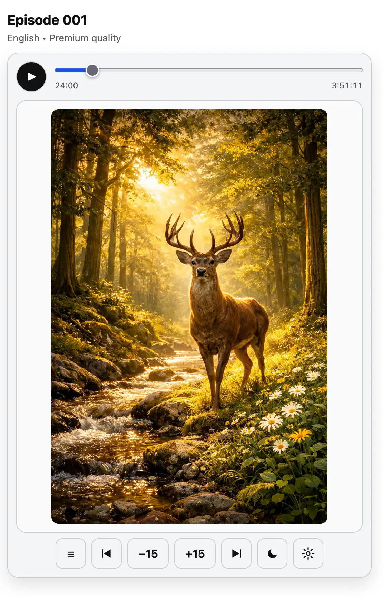

# Compact Audio Player

A dependency-free audiobook and podcast player for static websites. It supports multiple audio languages, WebVTT chapters, selectable quality, codec fallback, saved progress, and accessible custom controls.

Production uses plain HTML, CSS, and JavaScript. There is no build step and no runtime package dependency.

## Features

<p align="center">
  <a href="preview.webp">
    
  </a>
</p>

- Play and pause with lazy audio loading
- Seek bar, current time, duration, and configurable skip buttons
- Previous/next chapter, chapter selection, and current chapter display from WebVTT or embedded M4A/M4B metadata
- Audio-language and quality selection
- Opus, AAC/M4A, and MP3 sources
- Deterministic runtime source fallback
- Playback speed and supported programmatic volume control
- Timed sleep and sleep at the end of a chapter
- External or embedded M4A/M4B cover artwork and a full-size cover dialog
- System, light, and dark themes with three text sizes
- English, Danish, Norwegian Bokmål, and Swedish interface text
- Optional audiobook selector through `media/library.json`
- Optional Media Session lock-screen controls
- Saved progress per book and audio language
- Safe preference, chapter, and availability caching
- User-initiated offline download for one selected audiobook, language, and quality
- Keyboard controls, focus management, offline feedback, and reduced-motion support

Keyboard shortcuts outside focused controls are Space for play/pause, Left/Right Arrow for a five-second seek, Up Arrow for the configured skip forward, and Down Arrow for the configured skip backward. Escape closes open panels.

The first-visit **How this player works** dialog explains playback, chapters, shortcuts, Options, sleep timer, saved progress, chapter caching, and offline downloads. It also lets the user choose the interface language and audio language before starting. Set `ui.onboardingEnabled` to `false` in `library.json` to disable it for the whole player.

The player does not provide adaptive streaming, a playback queue, or transcript rendering.

## Run locally

ES modules require an HTTP server. Direct `file://` use is not supported.

```bash
python3 -m http.server 8080
```

Open `http://localhost:8080/`.

The example configuration references audio files that are not committed to this repository. Add the configured files under `media/episode-001/<language>/` to test playback.

## Create a new audiobook

The project includes the `create-audiobook` skill at `skills/create-audiobook/SKILL.md`. Use it when adding a new book from an M4A, M4B, or other audio source. A prompt such as `Use create-audiobook. Here is my audiobook: /path/book.m4b` guides the encoder through:

- four Opus WebM, AAC/M4A, and MP3 variants at 64, 96, 128, and 256 kbps
- embedded, WebVTT, or generated time-based chapters
- embedded or external cover-art selection
- a compatible `book.json` and minimal `books` entry in `library.json`
- output and configuration validation with `ffprobe` and Node.js

You can also ask for configuration only or to reuse the original audio. In those cases the skill inspects the existing files and does not encode extra variants.

The skill requires `ffmpeg` and `ffprobe`. It keeps the input file unchanged and does not commit or push generated files unless requested.

### Generate chapters for a book without them

`tools/make-chapters.py` writes a WebVTT chapter file for audio that has no chapter metadata. It splits the book into chapters of equal length, none longer than 20 minutes, then moves each boundary to the longest pause in the narration nearby. A chapter starts between sentences instead of in the middle of one.

```bash
python3 tools/make-chapters.py "media/my-book/My Book.mp3"
```

The file is written as `chapters.vtt` next to the audio. Use `-o` for another path, `--max-minutes` for a different limit, and `--title "Section {n}"` to replace the default `Part {n}` titles. An existing chapter file is kept unless you pass `--force`.

The titles are numbered parts because the script cannot tell where the book's own chapters begin. If the audio already has embedded chapters, use those.

The script needs Python 3, `ffmpeg`, and `ffprobe`. It decodes the whole file once to find the pauses, about a minute for a twelve-hour book, and never changes the audio. For a variable-bitrate MP3 without a length header it prints a warning: browsers estimate positions in such a file and may land a few seconds from a chapter start.

Afterwards, edit the language in `book.json`: set `chapterSource` to `vtt`, point `chapters` at the new file, and raise `cacheVersion`. One chapter file covers the Opus, AAC, and MP3 encodings of the same recording.

## Project structure

```text
index.html              Semantic player markup and dialogs
player.css              Responsive layout and design tokens
player.js               Starts the player with the current browser window and storage
sw.js                   Network-first app shell and offline ranged-audio responses
i18n.js                 Interface strings
js/
  player-app.js         Player startup, DOM event wiring, and feature coordination
  availability.js       HEAD and Range availability probes
  availability-session.js  Schedules scans after chapters load and records source availability
  chapters.js           WebVTT and embedded chapter loading
  chapter-session.js    Chapter cache, active source, navigation, and request cancellation
  codecs.js             Codec families, MIME hints, and quality labels
  preferences.js        Supported skip intervals and default
  config.js             Configuration validation and normalization
  book-config.js        Book loading, legacy filename fallback, and shared title requests
  book-selection.js     Language and quality choices for the active book
  cover.js              Cover loading, image fallback, and object URL lifetime
  custom-select.js      Select popups, keyboard navigation, and focus restoration
  dialogs.js            Dialog, panel, and focus behavior
  media-session.js      Browser media keys, metadata, and lock-screen position
  media-controller.js   Sole owner of audio source, seek, and play transitions
  mp4-chapters.js       Bounded Range-based MP4 chapter and cover parser
  offline.js            Offline preflight, quota checks, chunk downloads, and manifests
  offline-book-store.js  Stored download records, validation, and recovery after interruption
  offline-manifest.js   Offline storage addresses and manifest validation shared with the worker
  offline-transfer.js   Version checks, range validation, and streamed audio chunks
  progress-writer.js    Batches listening positions and cancels pending writes on reset
  source-selection.js   MIME evidence, quality display, and fallback ordering
  sleep-timer.js         Timed and end-of-chapter pauses, countdown, and volume fade
  storage.js            Safe preferences, progress, chapter, and availability persistence
  utils.js              Shared utilities and abortable fetch retries
  vtt.js                WebVTT chapter parser
tests/                  Node built-in tests; no test packages required
media/                  Library, book, cover, and chapter data
skills/create-audiobook/ Prompt workflow for encoding a book and generating book.json
tools/make-chapters.py  Time-based WebVTT chapters for audio without chapter metadata
```

`startPlayer()` connects the controls to the player modules. `MediaController` owns the audio element’s source, playback, and seeking.

## Book configuration

Each book has its own `media/<folder>/book.json`. The separate `media/library.json` is a catalog of book IDs and folders, not a second copy of their configuration. This keeps each book's audio, chapters, artwork, and configuration together.

The player prefers `book.json` and accepts the old `episode.json` filename as described under [Migrating existing sites](#migrating-existing-sites). The bundled example keeps its stable `episode-001` ID and media folder.

Required fields:

- `id`: stable book identifier
- `defaultLanguage`: language code used when no saved or browser match exists
- `languages`: map of language code to language configuration

Common optional fields:

- `title`: localized title map
- `cover`: path or HTTP(S) URL; image data URLs are also accepted
- `coverSource`: `file`, `embedded`, `auto`, or `none`; existing configurations with `cover` default to `file`
- `duration`: duration hint in seconds
- `cacheVersion`: change this when audio or chapter files are updated, added, or removed
- `debug.showAllQualities`: show all codec families and technical details

Example:

```json
{
  "id": "episode-001",
  "defaultLanguage": "en",
  "title": {
    "en": "Book 001",
    "da": "Book 001"
  },
  "coverSource": "auto",
  "cover": "./episode-001.webp",
  "duration": 3600,
  "cacheVersion": 1,
  "debug": {
    "showAllQualities": false
  },
  "languages": {
    "en": {
      "label": "English",
      "basePath": "media/episode-001/en/",
      "chapterSource": "vtt",
      "chapters": "chapters.vtt",
      "sources": {
        "opus": {
          "96": "audio-96k.webm",
          "128": "audio-128k.webm"
        },
        "aac": {
          "96": "audio-96k.m4a",
          "128": "audio-128k.m4a"
        },
        "mp3": {
          "96": "audio-96k.mp3",
          "128": "audio-128k.mp3"
        }
      }
    }
  }
}
```

### Language fields

- `label`: visible language name
- `basePath`: optional base for source and chapter paths; resolved from the site root
- `chapterSource`: `vtt`, `embedded`, `auto`, or `none`; defaults to `vtt` when `chapters` is present
- `chapters`: WebVTT file name or URL; used by `vtt` and tried first by `auto`
- `sources`: map of codec, bitrate, and file path

Without `basePath`, source and chapter paths are resolved from the book folder.

Supported codec keys are `opus`, `aac`, and `mp3`. MIME types are derived as follows:

- WebM Opus: `audio/webm; codecs="opus"`
- Ogg Opus: `audio/ogg; codecs="opus"`
- AAC/M4A/M4B: AAC-LC (`audio/mp4; codecs="mp4a.40.2"`), HE-AAC v1 (`mp4a.40.5`), and HE-AAC v2 (`mp4a.40.29`), with a generic `audio/mp4` fallback
- MP3: `audio/mpeg`

Unknown fields are ignored. Invalid languages, bitrate entries, unsafe URL schemes, and empty source maps are rejected during normalization without changing the documented schema.

### Cover artwork

`coverSource` controls where the player gets the book cover:

- `file` uses the configured `cover` value.
- `embedded` reads artwork from an M4A, M4B, or MP4 audio source.
- `auto` tries the configured cover first and uses embedded artwork only if that image is missing or cannot be decoded.
- `none` hides the cover.

If `coverSource` is omitted, a configuration with `cover` keeps the earlier `file` behavior. A configuration without `cover` defaults to `none`.

Embedded artwork is read from the MP4 `covr` metadata with bounded HTTP Range requests. JPEG and PNG images up to 10 MB are accepted. Reading artwork runs independently of playback and does not assign or preload the audio element. When chapters and artwork come from the same file, both parsers share one `moov` request and keep the result in memory for 30 seconds. This avoids downloading large MP4 metadata twice during startup.

The server must support byte ranges and, for cross-origin audio, expose the required CORS headers. A downloaded M4A/M4B can supply its artwork while offline because the service worker supports byte ranges over the saved audio chunks.

## Optional library

Add `media/library.json` to show an audiobook selector when more than one valid entry exists:

```json
{
  "default": "episode-001",
  "ui": {
    "onboardingEnabled": true
  },
  "books": [
    { "id": "episode-001" },
    { "id": "episode-002" }
  ]
}
```

Each entry needs only a stable `id`. Its folder defaults to that ID; add `folder` only when the directory name differs. Titles belong in each book's `book.json` and are the source for both the player heading and library selector.

`ui.onboardingEnabled` is a library-wide setting. It defaults to `true`; set it to `false` when the first-visit help dialog should never open automatically. Book-level onboarding settings are no longer used because the browser stores onboarding state once for the whole player.

The selected book configuration loads during startup. Other titles load when Options is first opened, with at most two small configuration requests running at once. Configurations are kept in memory for the rest of the page session, so selecting a book does not request the same `book.json` again. Until a title is available, the selector uses the entry ID. A failed optional title request does not prevent the current book from playing.

Library-level `title` and `label` values remain accepted for backward compatibility and as initial fallback labels. Legacy `audiofiles`, `episodes`, and `items` collections are accepted in that order when `books` is absent. If `books` is present, it takes precedence, even when empty; an invalid non-array `books` value produces an empty catalog rather than revealing a legacy list. Existing `defaultId`, `path`, `episode`, `key`, and `label` aliases remain supported.

Use `?book=<id>` to select a book. Old `?episode=<id>` links still work. A non-empty `book` parameter wins when both are supplied; an invalid value does not fall back to `episode`. Query values not present in the library are restricted to safe single-folder identifiers. After a successful selection, the player updates the URL to `?book=<id>`.

Startup still prefers a downloaded book while offline, then a valid query, a saved library selection, the library default, and finally the legacy `episode-001` ID.

## Migrating existing sites

1. Deploy the updated player files, including the new book-loading module and service worker, before renaming configuration files.
2. Optionally rename each `episode.json` to `book.json`. Keep the JSON fields, book ID, folder, audio paths, and `cacheVersion` unchanged for a filename-only migration.
3. Prefer `books` for the catalog collection and `?book=<id>` for new links. Replace the old collection key instead of adding a second competing list.

Migration is optional: existing configurations, catalogs, and links continue to work. If both configuration filenames exist, `book.json` wins. Avoid maintaining different versions of the same book under both filenames.

The loader tries `episode.json` only after `book.json` returns HTTP 404/410 or a network failure, including a timeout or interrupted response body. The timeout covers the headers and the response body for book configurations, the library, WebVTT files, and MP4 metadata ranges. Malformed JSON, invalid book configurations, and other HTTP errors are reported directly. Failed loads remain retryable. Concurrent selection and title requests share one load, while a cancelled selection cannot update a newer one.

Existing preferences and progress are read from the original storage keys until the installation saves its own values or is reset. Offline manifests retain their existing fields, including `episodeId` and `episodeTitle`. On offline startup the player uses the configuration URL recorded with the download. This also works for a custom book folder or a legacy `episode.json` when the catalog is unavailable.

If loading the catalog fails, the player retries when connectivity returns or Options opens online. If startup also failed to open a book, the player opens the selection from the recovered catalog. A book already open keeps playing. The next selection uses the folder in the recovered catalog, including when a book has moved. Updating the service-worker shell preserves downloaded media. If registration fails while this installation's worker still controls the page, the player can read its published download.

## WebVTT chapters

The selected language's chapters start loading after the book configuration. This request is independent of audio loading and never blocks playback. Opening the chapter panel, using chapter navigation, or selecting sleep at chapter end reuses the loaded data or the same in-flight request.

```vtt
WEBVTT

00:00:00.000 --> 00:05:12.000
Introduction

00:05:12.000 --> 00:18:30.000
Chapter 1
```

The parser accepts cue identifiers, cue settings, multiline titles, comma or period millisecond separators, and NOTE, STYLE, and REGION blocks. Malformed cues are skipped. Chapter text is rendered as text, not HTML. The active chapter title appears after language and quality in the player summary; it is omitted before the first cue, in gaps between cues, and after the last explicit end time. In a gap, Previous chapter returns to the preceding cue and the chapter sleep timer is unavailable. When a quality change or automatic fallback supplies different chapters, the timer follows the current chapter in the new source. It turns off if that chapter has no usable end time. Minute timers keep their original deadline.

## Source selection and fallback

The language selector lists languages with at least one usable audio URL. When a preferred language has no usable source, the player can open the book in its default language.

`canPlayType()` provides initial evidence, not a guarantee. AAC sources are tested against AAC-LC, HE-AAC v1, HE-AAC v2, and generic MP4 audio MIME hints. Runtime decoding remains the final authority, and there are no iOS-version codec rules.

The initial codec preference is:

1. Opus
2. AAC
3. MP3

The normal quality selector shows one codec family. Set `debug.showAllQualities` to `true` when inspecting every configured source.

For each source transition, the player creates a finite queue:

1. The selected source
2. Other bitrates from that codec, ordered by distance from the selected bitrate
3. Remaining codec families in preference order

A confirmed decode or unsupported-source failure skips the rest of that codec family. A network/source failure may try another bitrate before moving to the next codec. Each URL is attempted once per transition. A book opened offline keeps its other configured sources available for fallback when the connection returns.

Choosing a quality in Options saves it immediately. An automatic fallback becomes the saved quality once the browser starts playing it. If a new book fails to open, the current book keeps its playback position and sleep timer.

`NotAllowedError` stops automatic attempts and asks the user to press Play again. Old Promise rejections, media events, probes, chapter loads, and book responses are ignored after a newer generation takes ownership.

## Lazy loading

The audio element starts with `preload="none"` and no `src`. Pressing Pause or Space during the first load cancels the pending start, including a retry when the connection returns.

- Page load does not assign an audio source.
- Language or quality changes before playback only update the pending selection.
- Seeking or choosing a chapter before metadata updates the pending start time.
- The first Play action assigns the source and calls `play()` within the same user gesture.
- Source changes while playing preserve position, playback rate, and playback intent.

The pending position survives zero-time events during source reloads. A chapter seek made before metadata arrives, or followed by a source fallback, is applied when the new source is ready.

Browsers control actual buffering and may treat `preload` as a hint after a source is assigned.

If a connection loss interrupts playback, the player retries when the connection returns. A pause from the audio element also updates the controls. After a pause, the book stays paused through reconnection until you press Play.

## Offline downloads

Options includes **Download for offline use** when Service Worker and Cache Storage are available. It downloads the current audiobook, audio language, and quality. Cancel is available from the first size check, which times out after 20 seconds. While a replacement downloads, Cancel discards the partial copy and keeps the saved book. Once the player starts activating the completed replacement, the Cancel button disappears. If space is too low for both books, the player keeps the saved copy. You can free space or use **Remove download** before trying again.

The download also stores the player shell, book configuration, cover, and chapter file needed for an offline reload. A missing optional cover or chapter file does not prevent audio from being saved. The player uses the network first whenever it is online and keeps the completed copy as a fallback. Returning online does not delete the download.

The player stores audio in 8 MiB chunks. With a strong version validator, the player requests sequential byte ranges using If-Range. Without one, it requests a single range covering the file and splits that response as it arrives. Each audio response must match the MIME type established by the initial probe. After an interruption, **Resume download** reuses saved chunks when the server confirms the same file version with a strong ETag or a reliable Last-Modified date. If the version has changed or cannot be confirmed, the download starts again from the first chunk. Explicit cancellation marks the partial copy for removal before deleting it. If the tab closes during cleanup, the next visit discards the canceled copy. Playback traffic has priority while the player is loading or stalled.

One tab at a time can change an installation’s offline book. Other tabs can open the saved book while a replacement downloads. The player uses Web Locks for coordination, with IndexedDB as a fallback. If the browser denies the write lock, the saved book remains available for playback and the player hides the download controls.

If activation fails after the replacement has finished downloading, the previous book stays available. Choose **Resume download** or reopen the player to activate the complete copy from local storage.

Before downloading audio chunks, the player opens the cached book configuration and checks the book ID, cache version, language, quality, and audio URL against the selection. A failed check keeps the previous offline book available. The player also checks the audio MIME type and the completed download manifest. If the server omits the content type or sends a generic binary type, the player uses the configured audio format.

At startup the player checks the required configuration before listing a download as ready. If the configuration is missing or invalid and the audio is intact, **Restore book configuration** in Options fetches just the saved configuration URL. A separate paused download keeps its own progress during a repair. After a replacement becomes active, any failed cleanup of the previous download is retried on the next visit.

If Cache Storage reports a read error during startup, the player keeps the saved book and checks it again on the next visit. When the browser blocks access to Cache Storage, the player hides the download controls and can still play online.

Offline download requires:

- HTTPS in production or `http://localhost` during development
- audio hosted on the same origin as the player
- valid HTTP `206 Partial Content` responses with `Content-Range` and a known total size
- enough browser-managed storage for the selected source

The player checks `navigator.storage.estimate()` before starting and requests persistent storage where supported. Quota values are estimates, persistence can be refused, and browsers may evict site data later. Keep the page open while downloading; iOS and other mobile browsers can suspend page work in the background.

Online audio requests go directly through the browser's media loader. This avoids a [Firefox service-worker streaming issue](https://bugzilla.mozilla.org/show_bug.cgi?id=1637325) that can interrupt chapter seeking. When the browser reports that it is offline, the service worker serves the downloaded audio's byte ranges. Other requests, including chapter and cover metadata, remain network-first with cached fallback. If the browser still reports an online connection during an outage, native audio requests cannot use the saved copy until it detects the offline state.

The player and service worker use the same rules to validate a completed download. When offline, the service worker can serve the player page, styles, and scripts even if the book manifest is unreadable. It reads one cached audio chunk at a time as the audio element requests data. Canceling a request during a seek stops further chunk reads for that request. Change `cacheVersion` when replacing an audio file. An older completed copy remains usable offline until the user replaces or removes it.

## Availability probing

Availability is advisory. Each source is `available`, `missing`, or `unknown`.

1. The player tries an abortable HEAD request.
2. If HEAD is inconclusive, it sends `Range: bytes=0-0` and cancels the response body after the headers arrive.

HTTP 200/206 and authenticated 401/403 responses remain playable candidates. HTTP 404/410 from both probe paths marks a source missing. CORS, proxy, timeout, and offline failures stay unknown.

Once a source plays, the player records its URL in the book's versioned availability cache. Later probe results cannot mark that URL missing while the cache entry is valid. Cached missing sources remain at the end of the runtime fallback queue.

Only the active audio language is scanned. Changing language cancels stale probe work and starts a scan for the new selection.

Results are cached for seven days. Change `cacheVersion` or use `?clearAvailCache=1` to discard the current book cache. The old `?resetProbe=1` parameter is accepted as a harmless no-op because session-wide probe disabling no longer exists.

## Chapter loading

When a book opens or the audio language changes, the selected language's WebVTT file starts loading before cover or availability checks, even if the audio is still buffering. It does not assign or preload an audio source. Normal HTTP caching applies. Successful responses are also stored in guarded localStorage by book, audio language, chapter URL, and `cacheVersion`, so repeat visits can display chapters without another request.

Audio availability probes wait until chapter loading finishes and the browser is idle. Opening Options starts the scan sooner, but an active chapter request keeps priority. Chapter requests allow 20 seconds per attempt. Failed requests and HTML error pages show a Retry action in the chapter panel and are retried when connectivity returns. A valid WebVTT file with no cues displays an empty chapter list.

Each stored VTT file is limited to 512 KB. Change `cacheVersion` whenever a chapter file changes. Reset Player removes the persistent chapter cache. Storage restrictions, corrupt values, or quota errors disable this extra cache without affecting network chapter loading.

## Embedded M4A/M4B chapters

Set a language's `chapterSource` to `embedded` to read QuickTime chapter tracks or Nero `chpl` metadata from the active M4A/M4B source. Use `auto` to try the configured WebVTT file first and fall back to embedded metadata. Embedded metadata is read with bounded HTTP Range requests, so the player does not fetch the complete audiobook just to find chapter markers.

```json
{
  "chapterSource": "embedded",
  "sources": {
    "aac": { "128": "book.m4b" }
  }
}
```

When Opus or MP3 is selected, embedded chapters are unavailable for that source. Selecting an M4A/M4B quality loads its chapters. Use WebVTT for chapters shared across formats.

Embedded chapters reload when the language, quality, or fallback source changes. The parser follows top-level MP4 atom sizes, skips the media-data atom without downloading it, and reads a `moov` atom located at either end of a large audiobook. MP4 metadata is limited to 16 MB. QuickTime text samples are trimmed to their declared title length so trailing format records do not appear in chapter names.

The parser runs independently of playback and requires a server that supports byte ranges and the necessary same-origin or CORS response headers. If loading fails, the Chapters panel offers Retry and the player tries again when the connection returns. This also works for books whose only chapter source is the audio file. Embedded cues are cached per book, language, cache version, and source URL.

## Storage

Playback and seeking update the saved position for each book and audio language. Closing a passive tab preserves the latest position saved by the tab you listened in, including a deliberate seek backward.

If the browser blocks access to `localStorage`, the player opens the book with the default settings. Playback works, but settings and progress cannot be saved for the next visit. Storage reads and writes also handle malformed JSON, obsolete values, and quota errors.

Each installation prefixes new storage keys with `compactPlayer@<encoded-folder>:`. The folder comes from the page's directory, so direct links and query parameters use the same saved position. The keys within each installation are:

- `book:<encoded-book>:<reset-id>:selection` stores the selected language and quality
- `book:<encoded-book>:<reset-id>:progress` is the older combined position record, still used as a fallback
- `book:<encoded-book>:<reset-id>:progress:<encoded-language>:<revision>` stores a listening position and its activity time. Concurrent saves have separate keys. The player resumes from the latest activity and removes older revisions on the next save. It also reads earlier per-language keys without a revision.
- `compactPlayer:ui`: theme, text size, player language, speed, volume, and skip interval
- `compactPlayer:lastEpisode`: last library selection
- `compactPlayer:chapters:<book>:<language>:<cacheVersion>`: cached WebVTT chapter text
- `compactPlayer:chapters:<book>:<language>:<cacheVersion>:<source>` stores embedded chapters for one audio source
- `compactAudioPlayer.onboardingShown.v1`: onboarding state
- `cap_avail_*`: legacy availability cache

Older `compactPlayer:<book>` records remain readable. Books named `ui` or `lastEpisode` now have separate storage from the global settings. If an older settings key contains recognizable book data, the player copies it before updating that key. The reset ID is empty until the first reset. Each reset changes the ID so queued progress from an older tab cannot restore cleared positions. Older, unprefixed values remain available to other installations.

Availability writes use `compactPlayer:availability:<book>:<cacheVersion>`. Chapter entries record their source URL and timestamp. The player stores one WebVTT text per book, language, and current version. Different audio sources can retain their own embedded chapters in that version. Saving a new version clears obsolete chapter entries for the same book and language.

Progress writes are throttled and flushed when the page is hidden or left.

Cache Storage holds one completed audiobook and one interrupted download per player installation. Players hosted in different folders on the same origin manage their downloads separately, even when they use the same audio URL. Older downloads still belong to the folder containing their manifest URL. Reset Player clears the current installation's downloads and the saved settings listed above. If another tab is updating downloads, the reset dialog reports the conflict. If either store cannot be cleared, the dialog lists the unfinished part. **Try again** retries only that part. The service-worker app shell remains installed so a later online visit can refresh it.

## Accessibility and keyboard controls

Controls use native buttons, labels, fieldsets, outputs, sections, and dialogs. Chapter and sleep panels use ordinary button semantics instead of ARIA menu behavior.

- `Space`: play or pause when focus is outside a control
- `Arrow Left` / `Arrow Right`: seek five seconds
- `Arrow Up` / `Arrow Down`: skip forward or backward using the configured interval
- `Escape`: close an open panel or dialog
- `Tab` / `Shift+Tab`: normal document and modal focus movement

Panels place focus inside when opened and restore it to their trigger when closed by Escape or a close action. Dialogs use the native modal API with a focus-trap fallback. Status announcements are deduplicated to avoid repeated screen-reader output.

Visual notifications for network state, playback errors, chapter loading, and sleep-timer changes are centered over the player card. They do not move the layout or intercept pointer input. A separate polite live region announces the same message to assistive technology.

The layout supports 320 CSS px viewports, browser zoom, long labels, safe-area insets, reduced motion, and forced-colors mode. Primary controls use 44 CSS pixel targets.

## Browser behavior and limitations

- Playback always requires a user action. The player does not attempt autoplay.
- iOS and iPadOS expose `audio.volume` but do not apply programmatic changes. The volume control is hidden there.
- Media Session is optional. Unsupported actions or metadata failures do not affect normal playback.
- Lock-screen controls, background playback, interruptions, route changes, and app switching remain controlled by the operating system and browser.
- Cross-origin configuration, chapter, image, and audio servers must permit the requests they receive. Authentication and CORS policies vary by deployment.
- Cross-origin audio remains available for normal playback but cannot use the offline-download control.
- Device codec support can differ from `canPlayType()` results. Runtime fallback is the final authority.
- Offline downloads are best-effort browser storage. Clearing website data, private-browsing restrictions, quota pressure, or browser eviction can remove them.
- Downloads do not continue as background jobs after the browser suspends or closes the page. An interrupted download can resume when the player is open and online again.

## Tests

Run the dependency-free checks with:

```bash
node --check player.js
node --check sw.js
for file in i18n.js js/*.js tests/*.mjs; do node --check "$file"; done
node --test tests/*.test.mjs
git diff --check
```

Run `python3 tests/test_make_chapters.py` to check the chapter generator with short recordings. This test uses `ffmpeg` and `ffprobe`.

The tests cover:

- Book configuration, legacy filename fallback, collection aliases, query precedence, request reuse, cancellation, and lazy title concurrency
- URL and MIME handling
- Storage migration, corruption, chapter caching, reset behavior, and availability cache compatibility
- Offline manifest validation, size preflight, complete download promotion, interruption and resume
- Service-worker open-ended and suffix ranges, streamed `206` bodies, and network-first routing checks
- Cached chapter requests, HTTP failures, and WebVTT parsing
- Embedded QuickTime/Nero chapter parsing, large media-data atoms, title decoding, JPEG/PNG artwork, shared metadata requests, source changes, and chapter cache separation
- Source selection and fallback order
- blocked playback and codec rejection
- stale play Promise rejection after a newer source selection
- seeking before metadata
- duplicate HTML IDs and label associations
- active chapter metadata and configurable Up/Down Arrow shortcuts
- CSS custom-property references
- production dependency and lazy-preload checks

## Manual device matrix

Automated tests do not prove operating-system media behavior. Before a production release, test with real audio files on:

- iPhone Safari: first Play, source changes, offline download, airplane-mode reload and seeking, interrupted-download resume, lock screen, background/foreground, and volume-control visibility
- iPad Safari: the same flows in portrait, landscape, split view, and with a hardware keyboard
- Android Chrome, Firefox, and Samsung Internet: touch ranges, offline reload and seeking, app switching, screen lock, network loss, and Media Session controls
- macOS Safari, Chrome, Firefox, and Edge: keyboard controls, codec fallback, downloaded-copy replacement, storage reload, dialogs, zoom, and offline recovery

Also test 320, 360, 390, and 430 CSS pixel widths, tablet layouts, 200% zoom, long translated titles, reduced motion, and high-contrast/forced-colors modes.
